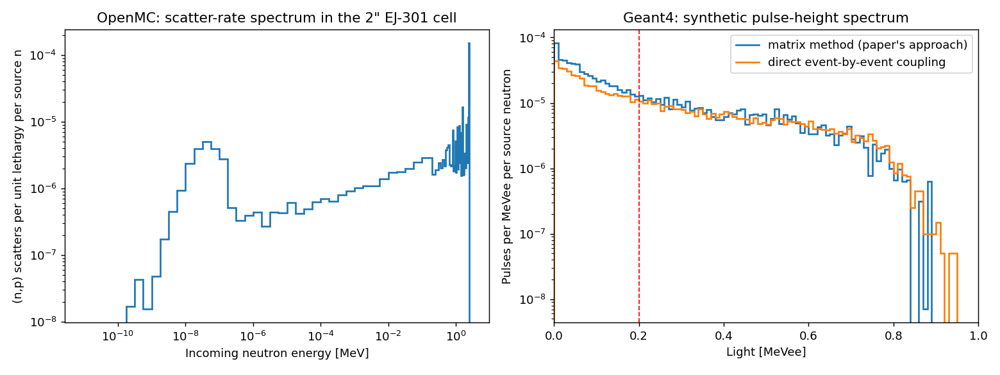

# Recreating the CMFX OpenMC + Geant4 detector calibration

This folder recreates the in-silico calibration of a 2"×2" EJ-301 liquid
scintillator in:

> J. L. Ball et al., "Measurements of Fusion Yield on the Centrifugal Mirror
> Fusion Experiment", arXiv:2505.23047 (2025), Sec. 2.1.2.

The paper's efficiency is split into two factors, ε = G·T:
- **G**, computed in OpenMC: elastic (n,p) scatters in the detector per emitted D-D neutron.
- **T**, computed from a Geant4 response matrix plus light-output and resolution functions: the fraction of those scatters giving a pulse above 200 keVee.

Paper values: G = 1.021e-4, T = 0.0389, ε = 3.97e-6 counts per source neutron.

Here OpenMC runs through its Python API and Geant4 through
`geant4_python_application`. The paper's matrix method is reproduced and
compared with a direct event-by-event coupling, in which every neutron OpenMC
sends into the detector becomes a Geant4 event.

## Steps

```bash
# OpenMC environment (openmc + h5py + nuclear data; uses mpiexec -n 8)
export OPENMC_CROSS_SECTIONS=/path/to/cross_sections.xml
python step1_openmc_cmfx.py                 # ~4 min; CMFX_LAYOUT=bunker for the sensitivity case

# geant4_python_application environment: create a fresh venv first
python -m venv .venv && source .venv/bin/activate && pip install geant4-python-application
python step2_geant4_response_matrix.py      # paper's method
python step3_geant4_direct.py               # direct coupling

python step4_compare.py                     # any env with matplotlib
```

**Variance reduction.** The detector sees about 1e-5 of the source. Step 1
therefore uses two-stage surface-source splitting:
- **Stage A** runs the full room and records every neutron entering a 60 cm sphere around the detector.
- **Stage B** replays each of them about 100 times inside the sphere only, with a vacuum boundary so nothing is counted twice.

## Taken from the paper vs assumed

**Taken from the paper:**
- 2.45 MeV source in an annulus of radii 5–21 cm, 60 cm long
- vessel radius 36.1 cm, central conductor, magnets 1.45 m apart
- detector ~3.1 m from centre
- shield wall and floor positions read off Fig. 5
- 200 keVee threshold

**Assumed:**
- all thicknesses and material mixes, and the extent of the wall along the axis
- no air, ceiling or other hall walls; no PMT, housing or mu-metal
- isotropic illumination for the response matrix
- light output: the Cecil (1979) NE-213 proton curve
- resolution: Dietze–Klein form with typical 2" parameters
- PSD: replaced by requiring that protons produce most of the light

The paper's model geometry is in N. R. Schwartz's PhD thesis (UMD, 2024), and
its measured light-output and resolution functions are in Ball et al., RSI 95,
123514 (2024). Neither was used here.

## Results

Two layouts: `fig5`, the shielding read off the paper's Fig. 5, and `bunker`, a
sensitivity case with different shielding. Both use the paper's matrix method
and the direct event-by-event coupling.

| Per source neutron | Paper | `fig5` matrix | `fig5` direct | `bunker` matrix | `bunker` direct |
| --- | --- | --- | --- | --- | --- |
| G: (n,p) scatters | 1.021e-4 | 3.64e-5 ± 0.06e-5 | — | 1.085e-4 ± 0.010e-4 | — |
| T: above 200 keVee | 0.0389 | 0.100 | 0.094 | 0.083 | 0.077 |
| **ε = G·T: counts** | **3.97e-6** | **3.65e-6 ± 0.07e-6** | **3.42e-6 ± 0.06e-6** | 9.06e-6 ± 0.10e-6 | 8.38e-6 ± 0.09e-6 |

- **Total efficiency.** The `fig5` layout reproduces the paper's ε to within
  8 % (matrix) and 14 % (direct).
- **Factors G and T separately do not match.** G is 2.8 times lower and T 2.6
  times higher than the paper, and the two errors largely cancel in ε. The
  scatter spectrum (below) suggests why: about a third of the (n,p) scatters
  come from neutrons below 1 eV, which can never give a 200 keVee pulse. This
  model has no air, ceiling or other hall walls, so it likely thermalises fewer
  neutrons than the real hall. That would lower G and raise T while barely
  changing ε. In the `bunker` layout G agrees with the paper (+6 %) but ε is
  2.3 times higher. Comparing G and T one at a time needs the paper's real
  geometry (Schwartz thesis).
- **Matrix vs direct.** The direct coupling gives 6–8 % fewer counts than the
  matrix method in both layouts. The matrix assumes isotropic illumination,
  while the real neutrons likely arrive from a preferred direction.
- **Code-to-code check.** Proton recoils above 100 keV per source neutron:
  OpenMC 1.053e-5, Geant4 on the same neutrons 1.032e-5 (ratio 0.980) for
  `fig5`; 0.988 for `bunker`.



Left: OpenMC (n,p) scatter-rate spectrum in the detector, with a thermal peak
and the 2.45 MeV D-D line. Right: the synthetic pulse-height spectra from the
two methods, with the 200 keVee threshold.

The `bunker` figure is in
[`results/bunker/cmfx_recreation.png`](results/bunker/cmfx_recreation.png).
