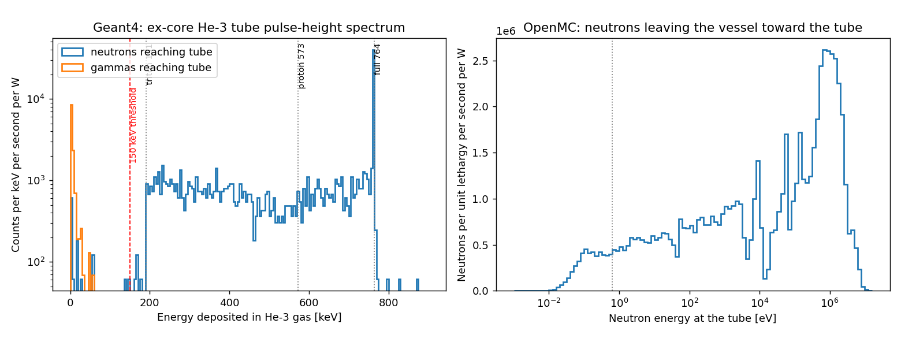

# Molten salt reactor → He-3 counter coupling example

A small MSRE-inspired core runs in OpenMC: LiF-BeF2-ZrF4-UF4 fuel salt in a
graphite lattice, inside a bare Hastelloy-N vessel, in eigenvalue mode. Every
neutron and gamma leaving the vessel's side wall is recorded. Geant4, through
`geant4_python_application`, then simulates an ex-core He-3 proportional
counter 90 cm from the core axis and produces its pulse-height spectrum.

Step 2 makes this cheap without biasing it:
- each leaked particle is copied at random angles about the core axis;
- only copies whose straight-line path hits the tube are kept (outside the vessel is void).

OpenMC also tallies He-3(n,p) on exactly those particles, which gives a
code-to-code check of the Geant4 detector stage.

```bash
# OpenMC environment (openmc, h5py, nuclear data with c_Graphite and photon libraries)
export OPENMC_CROSS_SECTIONS=/path/to/cross_sections.xml
python step1_openmc_core.py        # ~5 min
python step2_detector_source.py

# geant4_python_application environment: create a fresh venv first
python -m venv .venv && source .venv/bin/activate && pip install geant4-python-application
python step3_geant4_he3.py
python step3b_np_split.py          # optional: split counts into He-3(n,p) and other events

# anything with matplotlib
python step4_plot.py
```

Not modelled:
- fuel circulation, i.e. delayed-neutron precursors carried out of the core and gammas from the primary loop;
- temperature feedback;
- shielding around the detector;
- the 4-fold lattice asymmetry, which the azimuthal copies average over.

## Results

The OpenMC core gives k-eff = 1.1152 ± 0.0012. The core is MSRE-inspired but
not tuned to criticality; counts are normalised per watt of fission power
(7.03e10 source neutrons per second per W). 288,356 particles leave the
vessel, and 97,845 azimuthal copies hit the tube (53,322 neutrons and 44,523
gammas). Geant4 runs every one with `QGSP_BIC_HP`.

| | Value |
| --- | --- |
| Geant4 counts above 150 keV | 8.77e-6 ± 0.23e-6 per source neutron |
| Count rate | 6.17e5 ± 0.16e5 counts/s per W |
| OpenMC He-3(n,p) reactions, same particles | 9.023e-6 ± 0.027e-6 per source neutron |
| **Geant4 / OpenMC** | **0.972 ± 0.026** |
| Counts in the 764 keV full-energy peak | 34.8 % (the rest are wall-effect events) |
| Largest gamma deposit | 56 keV (no gamma counts above threshold) |

The uncertainty on the Geant4 rate is dominated by the core stage: copies of one
leaked particle are correlated, so the spread is taken over leaked particles.

**He-3(n,p) split** (`step3b_np_split.py`): 97.0 % of the OpenMC (n,p) rate
produces a triton in Geant4. Only 0.05 % of those events fall below the
150 keV threshold, and just 4 counted events have no triton. Geant4 and OpenMC
agree within about 3 %, which is within the statistical uncertainty.



Left: the Geant4 pulse-height spectrum, with the 764 keV full-energy peak, the
wall-effect continuum down to the 191 keV triton edge, and gammas confined
below about 60 keV. Right: the OpenMC neutron spectrum reaching the tube,
mostly fast and epithermal because nothing moderates it outside the vessel.

**Open question.** `QGSP_BIC_HP` does not include thermal neutron scattering
(S(α,β)) by default. It matters little here because there is no moderator
around the tube, but it must be added before modelling a moderated detector.
