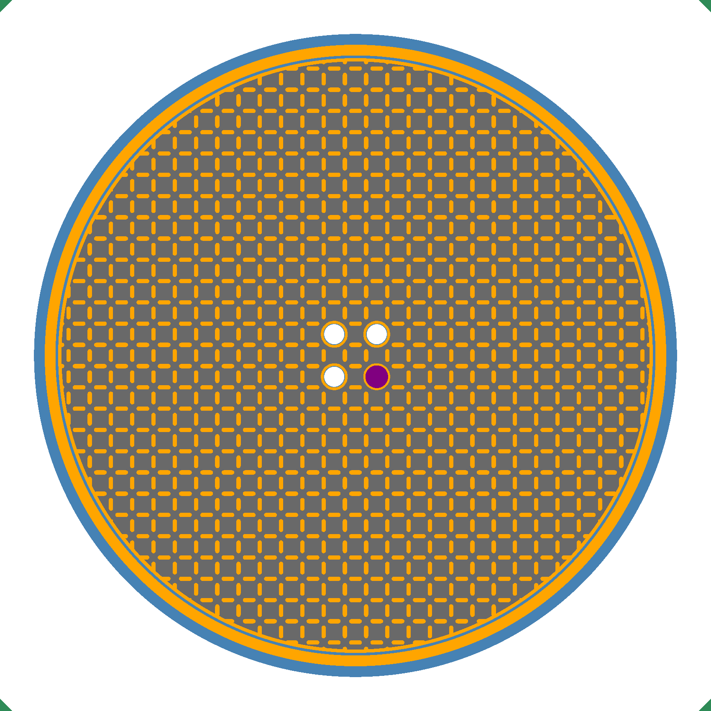

# MSRE first-criticality benchmark in OpenMC

Adds OpenMC to the comparison in

> K. T. Clarno, J. E. Barlow, T. Sawyer, J. Scherr, J. Hearne, P. V. Tsvetkov,
> "Evaluation of SCALE, Serpent, and MCNP for Molten Salt Reactor applications
> using the MSRE Benchmark", *Annals of Nuclear Energy* 194 (2023) 110092,
> doi:10.1016/j.anucene.2023.110092

which found that all three code families over-predict the MSRE's first
criticality (June 1965) by about 3 %, more than the experimental uncertainty.

The model is built from the open benchmark report, M. Fratoni, D. Shen, G. Ilas,
J. Powers, *Molten Salt Reactor Experiment Benchmark Evaluation*, OSTI 1617123
(2020). Exact inputs: fuel salt composition and density, uranium isotopics,
graphite density and boron, stringer and fuel-channel geometry, radial
dimensions, rod-thimble and sample-basket positions, 911 K. Details only shown
in the report's figures are simplified (see the docstring of `msre_model.py`);
`compare.py` corrects for the simplifications whose effect the report or a
later paper published.

```bash
# OpenMC environment
export OPENMC_CROSS_SECTIONS=/path/to/cross_sections.xml
python run_benchmark.py plot              # geometry slices in results/
python run_benchmark.py run 911 20000     # ~20 min with 8 MPI ranks
python run_benchmark.py run 911 20000 noshield
python compare.py
```

Outputs go to `results/`. Figures, summaries and model inputs are committed; HDF5
and `.npz` files are regenerated by the scripts and ignored by git.
Sensitivity variants are listed in
`msre_model.VARIANTS` and run with `run_benchmark.py run 911 20000 variant=NAME`.

## Result (ENDF/B-VII.0, 2.4 M active histories per run)

| | k-eff | C/E − 1 |
|---|---|---|
| Benchmark (experiment) | 0.99978 ± 0.00420 | |
| This model, corrected for published simplification effects | 1.0350 ± 0.0007 | +3.5 % |
| OpenMC CSG, ENDF/B-VII.1 (Frontiers 2024) | 1.02142 | +2.2 % |
| Serpent / MCNP / KENO, 2018 model | 1.025 – 1.031 | +2.6 to +3.1 % |

Like the published codes, OpenMC over-predicts the first criticality by far more
than the 420 pcm experimental uncertainty. This model sits about 1.35 % above
the refined OpenMC CSG model. Sensitivity runs rule out the vessel heads, plenum
volumes, support lattice, edge stringers and thermal shield as the cause (each
is small or acts in the other direction). The sample basket's INOR-8 content was
under-estimated (its worth was +1318 pcm against the published +1623) and is
now calibrated, which lowered k by about 300 pcm.

The nuclear data library is not the cause either. Only room-temperature
ENDF/B-VII.1 files were available per nuclide (openmc-data-storage, NNDC
processing), so both libraries were run with every material at 293.6 K:
VII.0 gave 1.09909 ± 0.00073 and VII.1 1.09973 ± 0.00061, a difference of
+59 ± 86 pcm. Applied to the hot result, the VII.1 estimate is
1.0356 ± 0.0011. The remaining gap most likely comes from geometry that only
the restricted IRPhEP specification details, such as the INOR-8 centring
bridge this model omits.

### Sensitivity runs (k-eff, ± 1σ statistical)

| Variant | k-eff | Effect vs base | Published |
| --- | --- | --- | --- |
| Base model, calibrated basket | 1.03189 ± 0.00066 | | |
| No thermal shield | 1.02803 ± 0.00062 | −666 ± 90 pcm | −885 pcm |
| Flat heads at true vessel height | 1.03986 ± 0.00061 | +477 ± 90 pcm | +243 pcm |
| Support lattice all salt (bound) | 1.03342 ± 0.00072 | −144 ± 96 pcm | — |
| Edge stringers without channels (bound) | 1.03448 ± 0.00077 | −42 ± 100 pcm | — |
| Basket → graphite (INOR-8 × 1.0) | | +1318 ± 91 pcm | +1623 pcm |
| Basket → graphite (calibrated) | 1.04856 ± 0.00064 | +1615 ± 89 pcm | +1623 pcm |
| Uncalibrated basket | 1.03492 ± 0.00069 | | |

Corrections from the as-modelled 1.03189 to 1.03498: flow distributor +98 pcm,
homogenised sample basket +37 pcm, all rods withdrawn −70 pcm, domed heads
+234 pcm.

Geometry plots:

| | | |
| --- | --- | --- |
|  |  |  |

Per-run k-eff values are in `results/*/keff.json`, and the exact OpenMC input
for each run is next to it as `model.xml`.

```bash
# library comparison at 293.6 K
python run_benchmark.py run 911 20000 cold lib=vii0 xs=/path/to/endfb70/cross_sections.xml
python run_benchmark.py run 911 20000 cold lib=vii1 xs=/path/to/endfb71/cross_sections.xml
```
