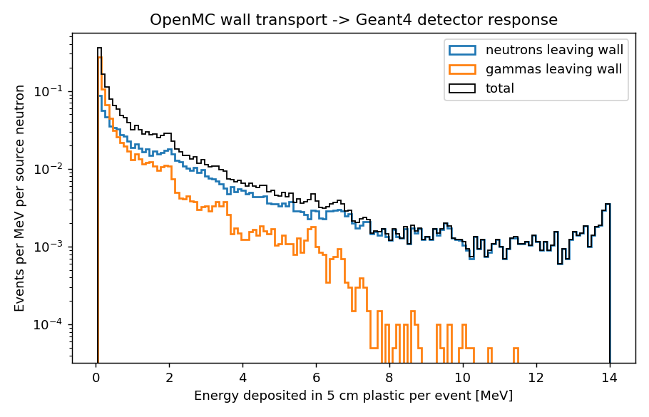

# OpenMC → Geant4 coupling example

OpenMC sends a 14.1 MeV neutron beam through 30 cm of concrete and records every
particle that leaves the outer face (a surface source). Geant4, through
`geant4_python_application`, starts those particles in a 5 cm plastic
scintillator and records the energy deposited per event.

The two codes can live in separate Python environments. Only a `.npz` file is
passed between them, so the Geant4 environment does not need h5py or OpenMC.

```bash
# OpenMC environment (needs openmc, h5py and nuclear data with photon libraries)
export OPENMC_CROSS_SECTIONS=/path/to/cross_sections.xml
python step1_openmc_shield.py

# geant4_python_application environment: create a fresh venv first
python -m venv .venv && source .venv/bin/activate && pip install geant4-python-application
python step2_geant4_detector.py          # optional argument: number of primaries

# anything with matplotlib
python step3_plot.py
```

Outputs go to `results/`. Figures, summaries and model inputs are committed; HDF5
and `.npz` files are regenerated by the scripts and ignored by git.
The coupling is one-way: OpenMC
particle weights and times are handled in Python, because the primaries array
accepts only particle, energy, position and direction.

## Results

200,000 source neutrons in OpenMC; 115,802 particles leave the outer face of the
wall (59,228 neutrons, 56,574 gammas). Every one is started as a Geant4 event.
All values are per source neutron.

| | Neutrons leaving wall | Gammas leaving wall | Total |
| --- | --- | --- | --- |
| Particles reaching the plastic | 0.296 | 0.283 | 0.579 |
| Energy deposited in Geant4 [keV] | 256.4 | 75.2 | 331.7 ± 3.0 |
| Counts above 100 keV | 0.088 | 0.066 | 0.154 |
| Fraction of particles counted | 29.8 % | 23.3 % | |

**Check against OpenMC.** OpenMC also tallies heating in the plastic in the full
model: 348.0 ± 1.9 keV per source neutron. Geant4 gives 331.7 ± 3.0 keV, so
Geant4/OpenMC = 0.953. That 4.7 % gap is larger than the statistical
uncertainty and is not yet explained. Candidates are the different heating
treatments (OpenMC uses KERMA-based heating, Geant4 tracks recoils and
secondaries) and the particle weights and times that the hand-off drops.



Neutrons give most of the signal above about 1 MeV, and gammas contribute
little above 8 MeV. The edge at 14 MeV is the uncollided
14.1 MeV neutrons depositing their full energy through proton recoils.
